🇰🇭 ភាសាខ្មែរ: [README.md](README.md)

---

# SmartFarm

**កម្មវិធីគ្រប់គ្រងហិរញ្ញវត្ថុកសិកម្ម សម្រាប់កសិករខ្នាតតូចកម្ពុជា**

> An offline-first financial management app for Cambodian smallholder farmers, built with SwiftUI and CoreData. Track income, expenses, and analyze farm profitability in Khmer or English. Supports both KHR (៛) and USD ($) currencies with local data storage.

---

## 📖 អំពី​កម្មវិធី (About)

**SmartFarm** គឺជាកម្មវិធីគ្រប់គ្រងហិរញ្ញវត្ថុកសិដ្ឋាន ដែលរចនាឡើងជាពិសេសសម្រាប់កសិករខ្នាតតូច នៅកម្ពុជា។ កម្មវិធីនេះជួយអ្នកតាមដានចំណូល ចំណាយ និងវិភាគប្រាក់ចំណេញកសិដ្ឋានរបស់អ្នកបានយ៉ាងងាយស្រួល។

**ចំណុចពិសេស:**
- 🌾 **តាមដានហិរញ្ញវត្ថុ** — កត់ត្រាចំណូល និងចំណាយរបស់កសិដ្ឋានបានទាន់ពេលវេលា
- 📊 **របាយការណ៍លម្អិត** — ក្រាហ្វិក និងការវិភាគប្រាក់ចំណេញប្រចាំខែ ប្រចាំសប្តាហ៍
- 💾 **បម្រុងទុក & ស្តារទិន្នន័យ** — នាំចេញជា JSON និងស្តារទិន្នន័យពេលត្រូវការ
- 🌐 **ភាសាទ្វេ** — ខ្មែរ (លំនាំដើម) និង English
- 💰 **រូបិយប័ណ្ណពីរ** — រៀល (KHR) និង ដុល្លារ (USD)
- 📴 **ធ្វើការ Offline** — ទិន្នន័យរក្សាទុកក្នុងឧបករណ៍ មិនត្រូវការអ៊ីនធឺណិត

---

## 🖼️ ទស្សនាកម្មវិធី (Screenshots)

<table>
<tr>
<td width="33%">

### 🌾 Onboarding
Welcome screen introducing SmartFarm's core features: track income, manage expenses, and analyze farm profitability.


</td>
<td width="33%">

### 📱 Dashboard
Home screen displaying monthly financial summary (income 1,205,000៛, expense 880,000៛, profit +325,000៛), quick action buttons, and recent transactions.

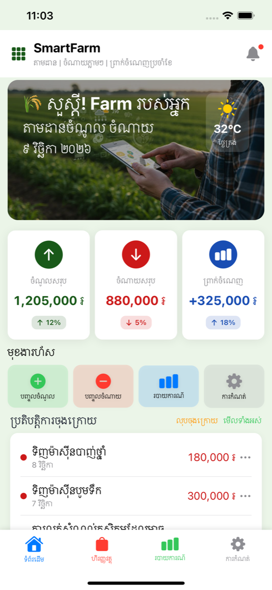

</td>
<td width="33%">

### 💰 Finance List
Transaction management screen with search, filter tabs, monthly summary cards, and chronologically grouped transaction history.

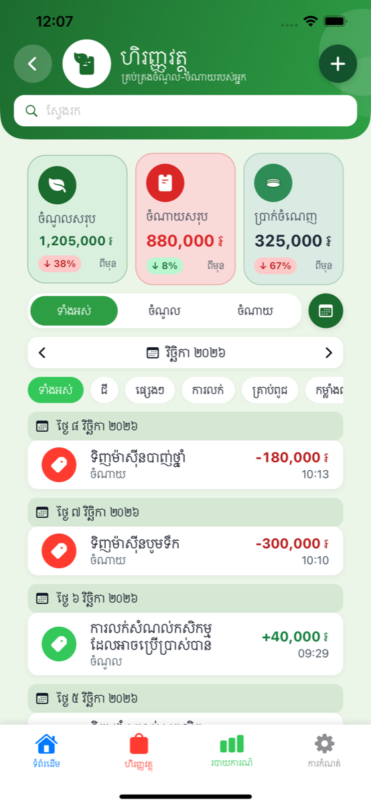

</td>
</tr>

<tr>
<td width="33%">

### 📅 Month Picker
Interactive month selection sheet for viewing historical financial data, showing available months with indicators.

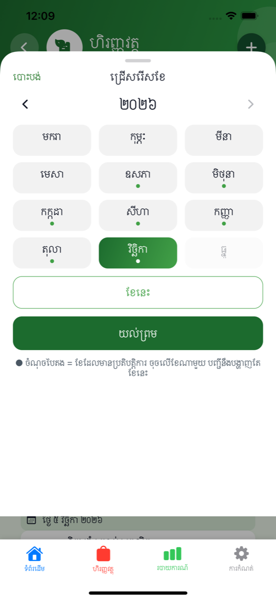

</td>
<td width="33%">

### 📊 Monthly Result
Detailed monthly breakdown for October 2026 (ខែ តុលា ២០២៦) showing income 1,950,000៛, expense 960,000៛, and profit 990,000៛ with transaction list.

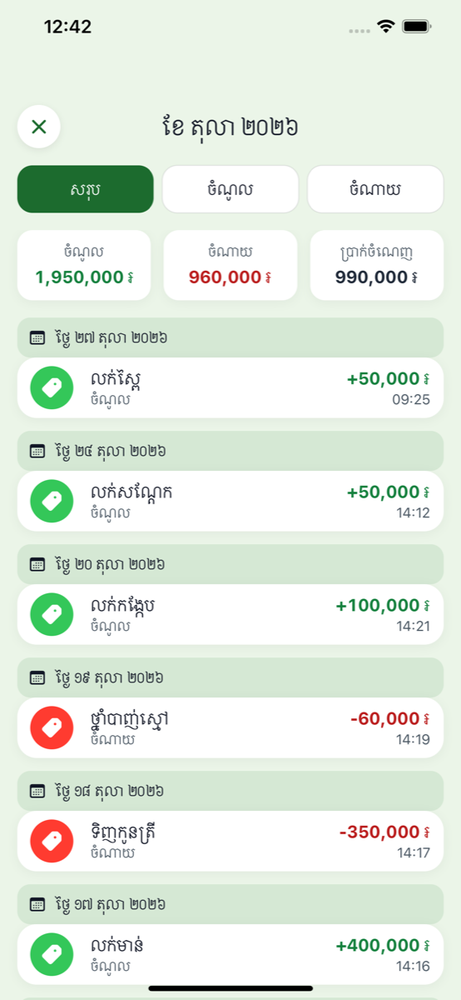

</td>
<td width="33%">

### ➕ Add Transaction
Transaction entry form with type toggle (Income/Expense), amount field, date picker, currency selector, and notes field.

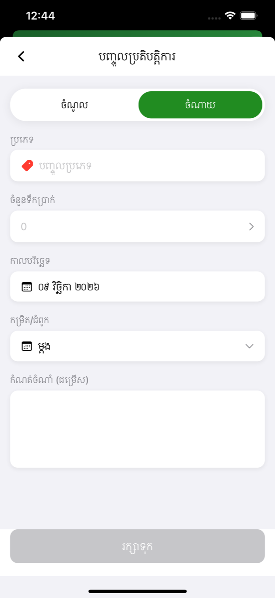

</td>
</tr>

<tr>
<td width="33%">

### 📈 Reports
Monthly reports overview with profit summary, weekly bar chart showing income/expense trends, and expense category breakdown pie chart.

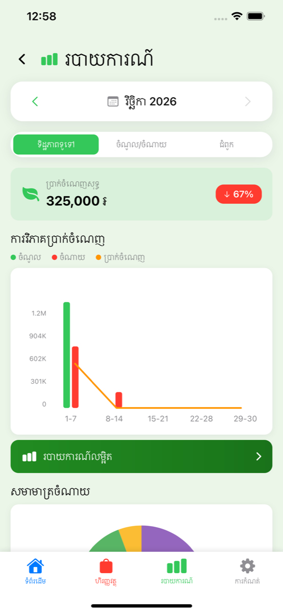

</td>
<td width="33%">

### 📊 Detailed Report
Comprehensive analytics view with time period selection (7/30/90 days, 1 year), summary cards, expense category donut chart, and income trend visualization.

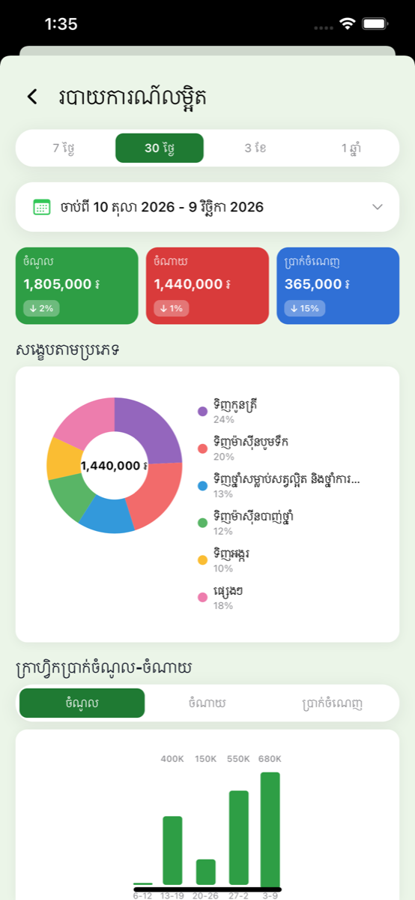

</td>
<td width="33%">

### ⚙️ Settings
Settings hub with farm profile card, language/currency preferences, backup/restore options, and access to help resources.

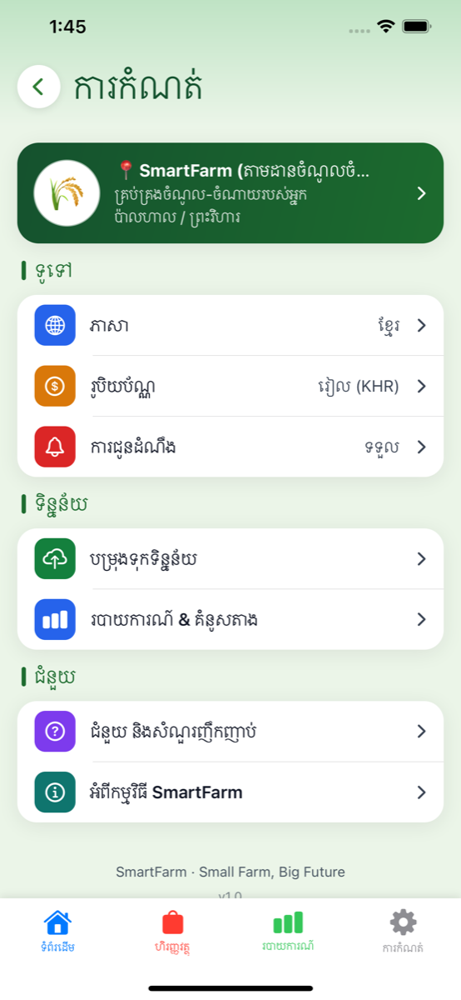

</td>
</tr>

<tr>
<td width="33%">

### 🌐 Language Selection
Bilingual support with Khmer (ខ្មែរ) as default and English option for app-wide localization.

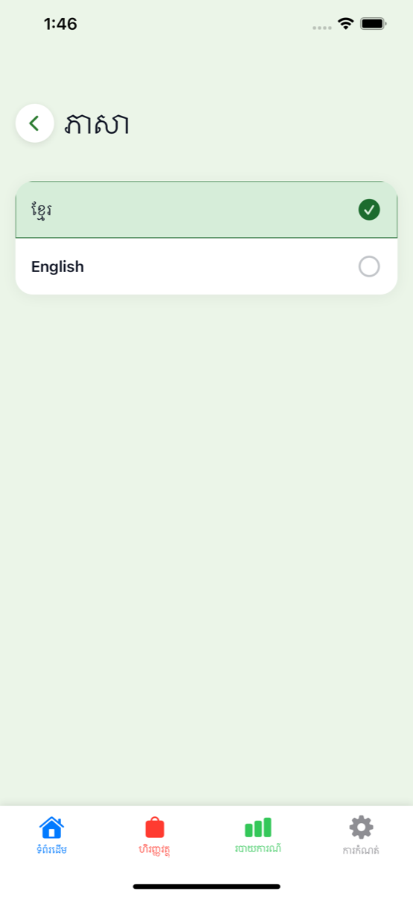

</td>
<td width="33%">

### 💵 Currency Selection
Dual-currency support: Cambodian Riel (រៀល - KHR) and US Dollar (ដុល្លារ - USD) for display preferences.

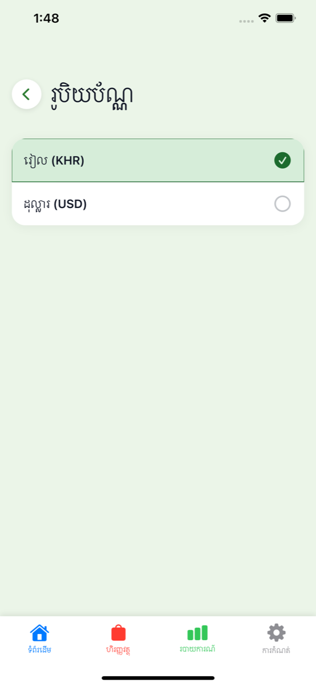

</td>
<td width="33%">

### 💾 Backup & Restore
Data backup system exporting transactions to JSON format with restore functionality for data recovery.

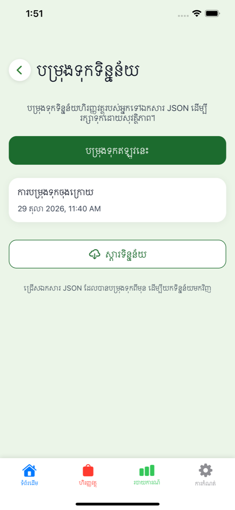

</td>
</tr>

<tr>
<td width="33%">

### ❓ Help & FAQ
5 frequently asked questions. Tap any question to open an answer screen that stays open until the user taps the Back button.


</td>
<td width="33%">

</td>
<td width="33%">

</td>
</tr>

<tr>
<td width="33%">

### ❓ FAQ Answer 1
First FAQ answer screen showing blue icon, question, and detailed answer text in white card.

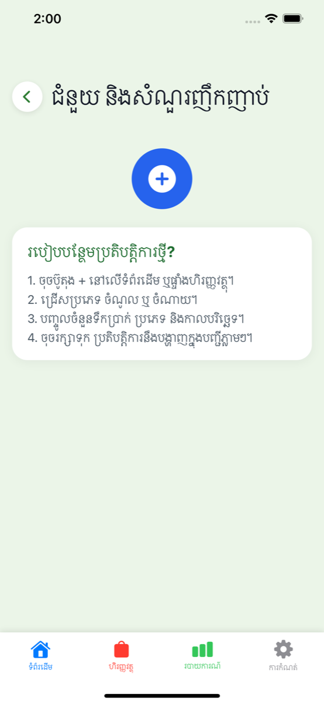

</td>
<td width="33%">

### ❓ FAQ Answer 2
Second FAQ answer screen showing orange icon, question, and detailed answer text in white card.

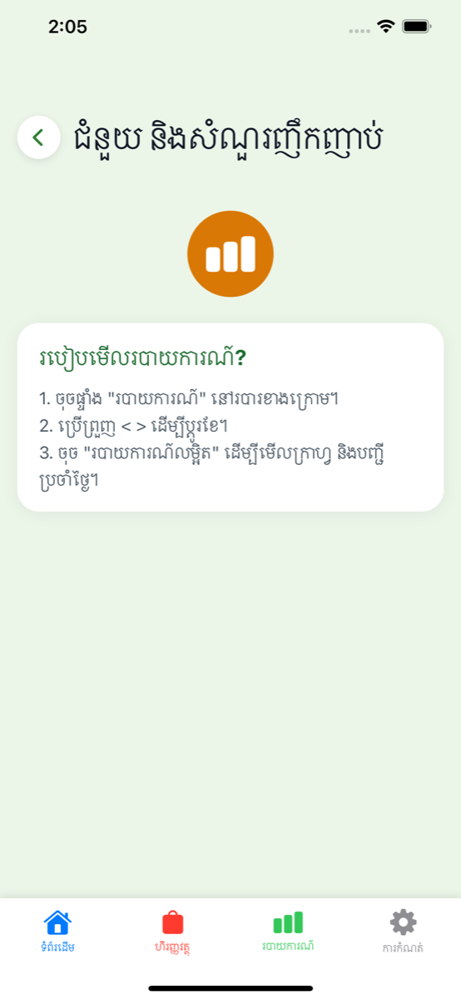

</td>
<td width="33%">

### ❓ FAQ Answer 3
Third FAQ answer screen showing purple icon, question, and detailed answer text in white card.

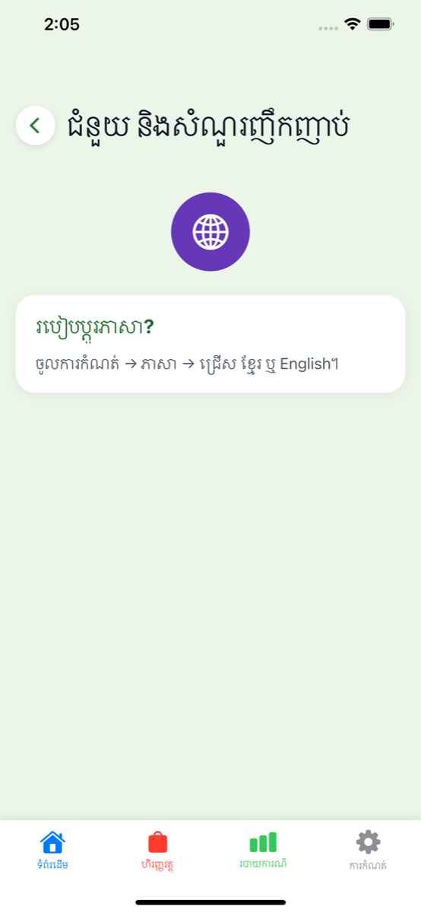

</td>
</tr>

<tr>
<td width="33%">

### ❓ FAQ Answer 4
Fourth FAQ answer screen showing green icon, question, and detailed answer text in white card.

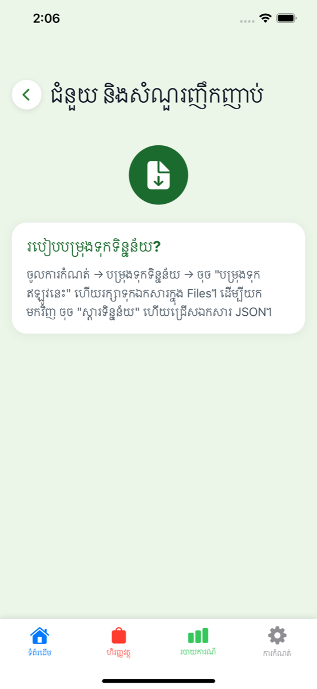

</td>
<td width="33%">

### ❓ FAQ Answer 5
Fifth FAQ answer screen showing brown icon, question, and detailed answer text in white card.


</td>
<td width="33%">

### ℹ️ About
App information screen showing SmartFarm version 1.0, app icon, and description of core features.

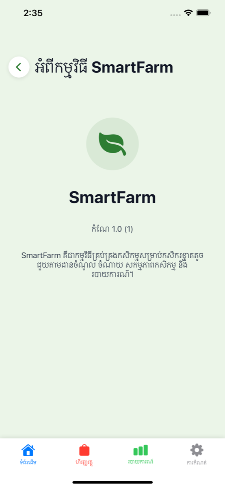

</td>
</tr>
</table>

---

## 🏗️ Architecture

SmartFarm follows **MVVM + Repository + Coordinator** pattern with strict separation of concerns:

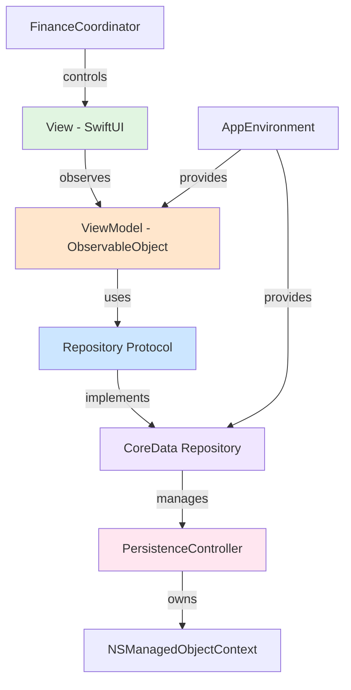

**Key Principles:**
- **Views** never import CoreData, only render domain models (`Transaction`, `FarmActivity`, `Reminder`)
- **ViewModels** depend on repository **protocols**, enabling unit testing with mocks
- **Repositories** are the single source of truth for Entity ↔ Domain struct mapping
- **AppEnvironment** provides dependency injection for all ViewModels and Repositories
- **Coordinator** (FinanceCoordinator) manages tab navigation and detail view routing

---

## 🧭 Navigation Flow

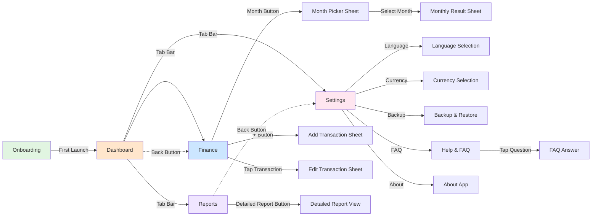

**User Flow:**
1. **First Launch**: Onboarding screen → Dashboard
2. **Main Navigation**: 4 tabs (Dashboard, Finance, Reports, Settings)
3. **Finance**: Browse transactions, filter by month, add/edit entries
4. **Reports**: View charts, detailed analytics
5. **Settings**: Configure language, currency, backup/restore data

---

## 💾 Data Flow

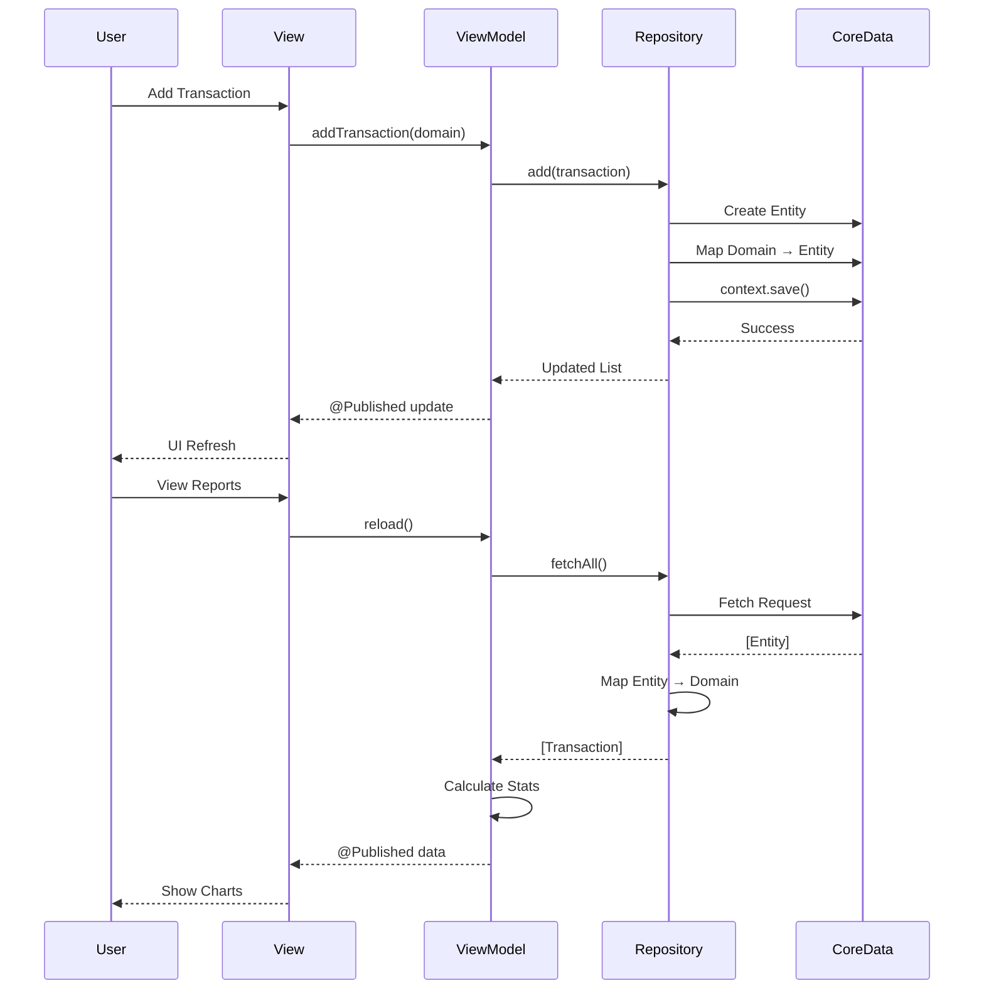

**Flow Steps:**
1. User interacts with **SwiftUI View**
2. View calls **ViewModel** methods
3. ViewModel uses **Repository Protocol**
4. Repository performs **CoreData** operations
5. Entities mapped to **Domain Models**
6. ViewModel publishes updates via **@Published**
7. View automatically re-renders

---

## 🗄️ CoreData Model

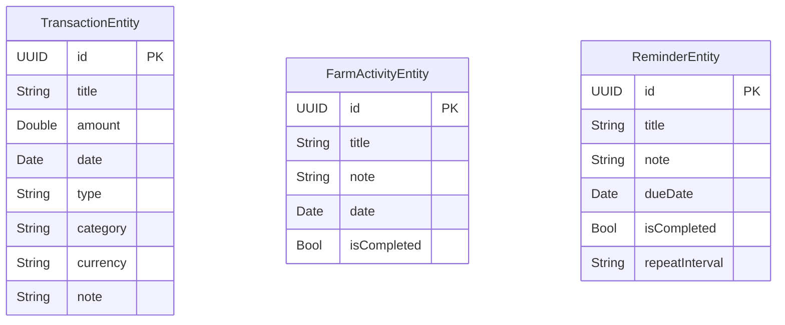

**Entities:**
- **TransactionEntity**: Income/expense records with amount, category, currency
- **FarmActivityEntity**: Farm tasks with completion status
- **ReminderEntity**: Scheduled reminders with repeat intervals

**Storage:**
- Persistent store: `SmartFarm.xcdatamodeld`
- Context: Single `NSManagedObjectContext` owned by `PersistenceController`
- All saves protected by `hasChanges` guard

---

## 📅 Development Timeline

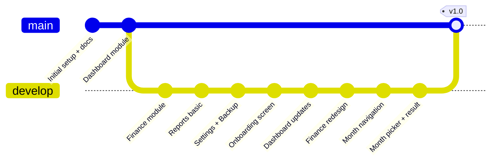

**Key Milestones:**
- **Initial Setup** (2024): Architecture docs, module specs, design system
- **Dashboard** (2024): Main screen with summary cards and quick actions
- **Finance** (2025): Transaction list, add/edit forms, month filtering
- **Reports** (2025): Charts, analytics, monthly navigation
- **Settings** (2025): Preferences, backup/restore, FAQ, About
- **Onboarding** (2026): Welcome screen for first-time users
- **Finance Enhancements** (2026): Month picker sheet, monthly result view

**Recent Commits:**
```
ba25d40 Finance: add calendar button with month picker sheet
fa825b4 Settings redesign with sub-screens, FAQ, backup/restore
f7f4b4c Redesign Finance screen: green scrolling banner, search
b330fc2 Add month navigation to Reports screen
a20e31d Improve DetailedReportView: thinner bar chart
```

---

## ✨ Features

### 📊 Financial Management
- ✅ **Transaction Tracking**: Record income and expenses with categories
- ✅ **Multi-Currency**: Support for KHR (៛) and USD ($)
- ✅ **Monthly Filtering**: View transactions by specific month
- ✅ **Search & Filter**: Find transactions by keyword, type, or category
- ✅ **Quick Actions**: Fast access to add income/expense from Dashboard

### 📈 Reports & Analytics
- ✅ **Profit Analysis**: Monthly/weekly profit trends with percentage changes
- ✅ **Expense Breakdown**: Category-wise spending with pie charts
- ✅ **Bar Charts**: Weekly income vs expense visualization
- ✅ **Time Period Selection**: 7 days, 30 days, 3 months, 1 year views
- ✅ **Detailed Analytics**: Donut charts, trend lines, summary cards

### ⚙️ Settings & Preferences
- ✅ **Bilingual Support**: Khmer (default) and English
- ✅ **Currency Selection**: KHR or USD display preference
- ✅ **Data Backup**: Export all transactions to JSON
- ✅ **Data Restore**: Import transactions from backup file
- ✅ **Help & FAQ**: 5 common questions, tap to open answer screen

### 🎨 User Experience
- ✅ **Onboarding**: Welcome screen for new users
- ✅ **Offline-First**: All data stored locally, no internet required
- ✅ **Dark Mode Ready**: Supports system appearance preferences
- ✅ **Localized Dates**: Khmer numerals and date formatting
- ✅ **Custom Components**: Reusable design system (FarmCard, SummaryCardView, etc.)

---

## 🛠️ Tech Stack

### Core Technologies
- **SwiftUI**: Declarative UI framework (iOS 14+)
- **CoreData**: Local persistence layer
- **Combine**: Reactive programming (@Published, ObservableObject)
- **Swift 5.0**: Primary programming language
- **Xcode 13.x**: Development environment (objectVersion 55)

### Architecture Patterns
- **MVVM**: Model-View-ViewModel separation
- **Repository Pattern**: Protocol-based data access layer
- **Coordinator Pattern**: Navigation and routing (FinanceCoordinator)
- **Dependency Injection**: AppEnvironment provides ViewModels & Repositories
- **Domain-Driven Design**: Entity ↔ Domain Model mapping

### Design System
- **Theme**: Centralized colors, fonts, spacing (`Core/DesignSystem/Theme.swift`)
- **Components**: Reusable UI elements (FarmCard, PrimaryButton, SectionHeader)
- **Localization**: LocalizationManager with `L("key")` helper
- **Utilities**: CurrencyFormatter, LocalizedDate, NotificationService

### Development Tools
- **xcodeproj gem**: Programmatic Xcode project manipulation
- **Bundler**: Ruby dependency management
- **Git**: Version control with feature branches

---

## 📁 Project Structure

```
SmartFarm/
├── App/
│   ├── SmartFarmApp.swift          # App entry point
│   ├── AppEnvironment.swift        # DI container
│   └── AppSettings.swift           # User preferences
│
├── Core/
│   ├── Repositories/               # Data access layer
│   │   ├── TransactionRepository.swift
│   │   ├── FarmActivityRepository.swift
│   │   └── ReminderRepository.swift
│   ├── DesignSystem/
│   │   ├── Theme.swift            # Colors, fonts, spacing
│   │   └── Components/            # Reusable UI components
│   ├── Localization/
│   │   └── LocalizationManager.swift
│   └── Utilities/
│       ├── CurrencyFormatter.swift
│       ├── LocalizedDate.swift
│       ├── NotificationService.swift
│       ├── DocumentPicker.swift
│       └── ActivityShareSheet.swift
│
├── Onboarding/
│   └── OnboardingView.swift       # Welcome screen
│
├── Dashboard/
│   ├── Models/
│   ├── ViewModels/
│   │   └── DashboardViewModel.swift
│   └── Views/
│       ├── MainTabView.swift      # 4-tab navigation
│       └── DashboardView.swift
│
├── Finance/
│   ├── Models/
│   │   ├── Transaction.swift
│   │   ├── TransactionEntity+CoreDataClass.swift
│   │   └── TransactionEntity+CoreDataProperties.swift
│   ├── ViewModels/
│   │   ├── FinanceViewModel.swift
│   │   └── FinanceCoordinator.swift
│   └── Views/
│       ├── FinanceTabView.swift
│       ├── AddEditTransactionView.swift
│       ├── MonthPickerSheet.swift
│       └── MonthlyResultSheet.swift
│
├── Reports/
│   ├── ViewModels/
│   │   └── ReportsViewModel.swift
│   └── Views/
│       ├── ReportsView.swift
│       ├── DetailedReportView.swift
│       └── MonthlyBarChartView.swift
│
├── Settings/
│   ├── SettingsView.swift
│   ├── LanguageSelectionView.swift
│   ├── CurrencySelectionView.swift
│   ├── FarmProfileEditView.swift
│   ├── HelpFAQView.swift
│   └── AboutAppView.swift
│
├── Backup/
│   ├── BackupView.swift
│   └── BackupService.swift
│
├── en.lproj/
│   └── Localizable.strings        # English translations
├── km.lproj/
│   └── Localizable.strings        # Khmer translations
│
├── Persistence.swift              # PersistenceController
├── SmartFarm.xcdatamodeld/        # CoreData model
│
└── docs/
    ├── screenshots/               # App screenshots (PNG)
    ├── 00-architecture.md         # Architecture spec
    ├── 01-finance.md              # Finance module spec
    ├── 02-splash.md               # Splash spec
    ├── 07-reports.md              # Reports spec
    ├── 08-settings.md             # Settings spec
    ├── 09-localization.md         # i18n spec
    ├── index.html                 # Design preview
    └── question.html              # User survey
```

---

## 🚀 How to Run

### Prerequisites
- **macOS**: Big Sur 11.0 or later
- **Xcode**: 13.x (ships with iOS 15 SDK)
- **iOS Deployment Target**: 14.0 (minimum supported iOS version)
- **iOS Simulator**: iOS 15.2+ recommended, or physical device running iOS 14.0+

### Steps

1. **Clone the repository:**
   ```bash
   git clone https://github.com/Davy17601/smartfarm.git
   cd smartfarm
   ```

2. **Open in Xcode:**
   ```bash
   open SmartFarm.xcodeproj
   ```

3. **Select target:**
   - Choose `SmartFarm` scheme
   - Select an iOS 15.2+ simulator or connected device

4. **Build and run:**
   - Press `⌘R` or click the Play button
   - App will launch with onboarding screen (first time only)

### Adding New Swift Files

New `.swift` files must be registered in the Xcode project:

```bash
# Install xcodeproj gem (one time)
bundle install

# Add a new file to the project
bundle exec ruby -e "require 'xcodeproj'; \
  proj = Xcodeproj::Project.open('SmartFarm.xcodeproj'); \
  ref = proj.main_group.find_subpath('SmartFarm/Finance/Views', true).new_file('NewView.swift'); \
  proj.targets.first.add_file_references([ref]); proj.save"
```

### Command-Line Build

```bash
xcodebuild -project SmartFarm.xcodeproj \
  -scheme SmartFarm \
  -destination 'platform=iOS Simulator,name=iPhone 12 Pro Max,OS=15.2' \
  build
```

---

## ⚠️ Limitations

### Current Constraints
- **iOS 14.0 Minimum**: Must support Xcode 13 with iOS 14 deployment target
- **No Swift Charts**: iOS 16+ framework not available, using custom GeometryReader charts
- **No `.searchable()`**: iOS 15+ modifier unavailable, using custom TextField search
- **Local Data Only**: All data stored in CoreData, no cloud sync or remote backup
- **Fixed FAQ**: 5 questions hardcoded in localization strings, not expandable UI
- **Single User**: No multi-user support or user accounts
- **No Export to CSV/PDF**: Backup feature exports JSON only
- **Manual Currency Entry**: No automatic currency conversion or exchange rates

### Design Decisions
- **Offline-First**: Intentional design for farmers with limited internet access
- **Simple Categories**: Fixed category list for ease of use (not user-customizable)
- **Monthly View**: Optimized for monthly farm cycles rather than daily tracking
- **Bilingual Only**: Khmer and English supported; other languages require localization file additions

### Known Issues
- **Xcode 13 Required**: Contributors must use Xcode 13.x for guaranteed compatibility
- **No Tests**: Unit test suite not yet implemented (architecture supports mock repositories)
- **Preview Data**: Some previews use placeholder data instead of live CoreData

---

## 👨‍💻 Author

**SmartFarm v1.0**

Built with ❤️ for Cambodian smallholder farmers.

**Developed by:**
- **Davy** - [@Davy17601](https://github.com/Davy17601)

---

## 📄 License

This project is licensed under the MIT License - see the [LICENSE](LICENSE) file for details.

---

## 🙏 Acknowledgments

- **Cambodian Farmers**: For inspiring this project and providing real-world feedback
- **SwiftUI Community**: For open-source components and best practices
- **Design Resources**: Icons, fonts, and visual assets from Apple SF Symbols

---

**SmartFarm** · Small Farm, Big Future 🌾
