🇬🇧 English: [README.en.md](README.en.md)

---

# SmartFarm

**កម្មវិធីគ្រប់គ្រងហិរញ្ញវត្ថុកសិកម្ម សម្រាប់កសិករខ្នាតតូចកម្ពុជា**

> កម្មវិធីគ្រប់គ្រងហិរញ្ញវត្ថុ offline-first សម្រាប់កសិករខ្នាតតូចនៅកម្ពុជា សាងសង់ដោយ SwiftUI និង CoreData។ តាមដានចំណូល ចំណាយ និងវិភាគប្រាក់ចំណេញកសិដ្ឋានជាភាសាខ្មែរ ឬ អង់គ្លេស។ គាំទ្ររូបិយប័ណ្ណ KHR (៛) និង USD ($) ជាមួយការរក្សាទុកទិន្នន័យក្នុងឧបករណ៍។

---

## 📖 អំពី​កម្មវិធី

**SmartFarm** គឺជាកម្មវិធីគ្រប់គ្រងហិរញ្ញវត្ថុកសិដ្ឋាន ដែលរចនាឡើងជាពិសេសសម្រាប់កសិករខ្នាតតូច នៅកម្ពុជា។ កម្មវិធីនេះជួយអ្នកតាមដានចំណូល ចំណាយ និងវិភាគប្រាក់ចំណេញកសិដ្ឋានរបស់អ្នកបានយ៉ាងងាយស្រួល។

**ចំណុចពិសេស:**
- 🌾 **តាមដានហិរញ្ញវត្ថុ** — កត់ត្រាចំណូល និងចំណាយរបស់កសិដ្ឋានបានទាន់ពេលវេលា
- 📊 **របាយការណ៍លម្អិត** — ក្រាហ្វិក និងការវិភាគប្រាក់ចំណេញប្រចាំខែ ប្រចាំសប្តាហ៍
- 💾 **បម្រុងទុក & ស្តារទិន្នន័យ** — នាំចេញជា JSON និងស្តារទិន្នន័យពេលត្រូវការ
- 🌐 **ភាសាទ្វេ** — ខ្មែរ (លំនាំដើម) និង English
- 💰 **រូបិយប័ណ្ណពីរ** — រៀល (KHR) និង ដុល្លារ (USD)
- 📴 **ធ្វើការ Offline** — ទិន្នន័យរក្សាទុកក្នុងឧបករណ៍ មិនត្រូវការអ៊ីនធឺណិត

---

## 🖼️ រូបភាពអេក្រង់កម្មវិធី

<table>
<tr>
<td width="33%">

### 🌾 ទំព័រស្វាគមន៍
អេក្រង់ស្វាគមន៍ណែនាំមុខងារសំខាន់របស់ SmartFarm៖ តាមដានចំណូល គ្រប់គ្រងចំណាយ និងវិភាគប្រាក់ចំណេញកសិដ្ឋាន។


</td>
<td width="33%">

### 📱 ទំព័រដើម
អេក្រង់ដើមបង្ហាញសេចក្តីសង្ខេបហិរញ្ញវត្ថុប្រចាំខែ (ចំណូល 1,205,000៛ ចំណាយ 880,000៛ ចំណេញ +325,000៛) ប៊ូតុងសកម្មភាពរហ័ស និងប្រតិបត្តិការថ្មីៗ។

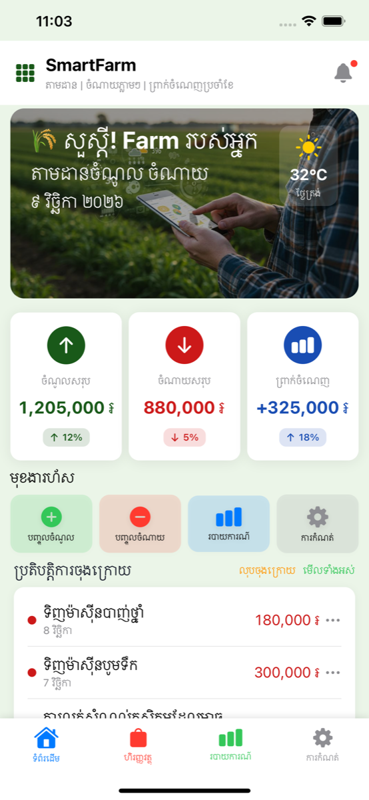

</td>
<td width="33%">

### 📊 ចំណាយតាមប្រភេទ
នៅខាងក្រោមទំព័រដើម (រមូរចុះក្រោម) មានក្រាហ្វិក pie និងបញ្ជីបង្ហាញប្រភេទចំណាយនីមួយៗជាមួយភាគរយ និងចំនួនទឹកប្រាក់។

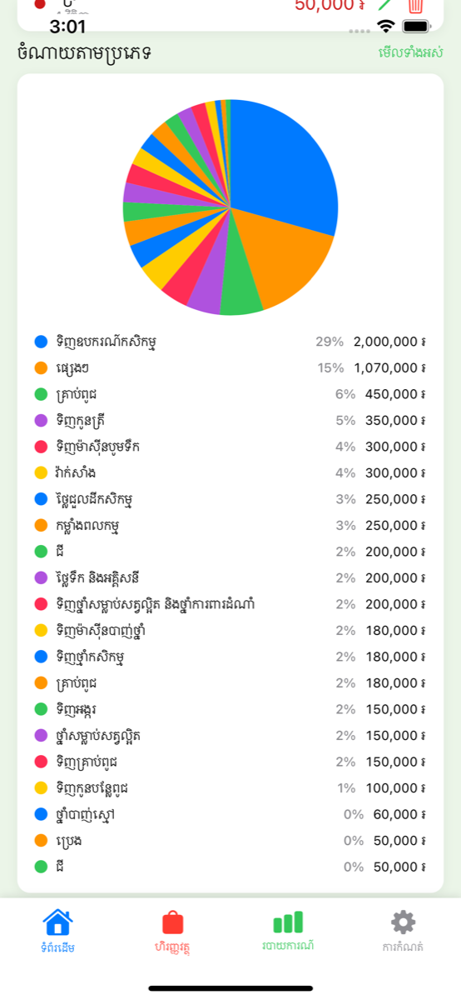

</td>
</tr>

<tr>
<td width="33%">

### 💰 បញ្ជីហិរញ្ញវត្ថុ
អេក្រង់គ្រប់គ្រងប្រតិបត្តិការជាមួយការស្វែងរក ផ្ទាំងច្រោះ កាតសង្ខេបប្រចាំខែ និងប្រវត្តិប្រតិបត្តិការតាមកាលបរិច្ឆេទ។

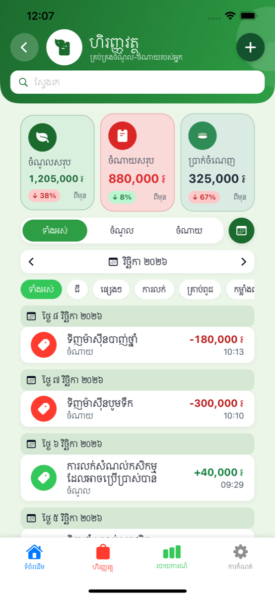

</td>
<td width="33%">

### 📅 ជ្រើសរើសខែ
ផ្ទាំងជ្រើសរើសខែសម្រាប់មើលទិន្នន័យហិរញ្ញវត្ថុប្រវត្តិសាស្ត្រ បង្ហាញខែដែលមានទិន្នន័យជាមួយសញ្ញា។

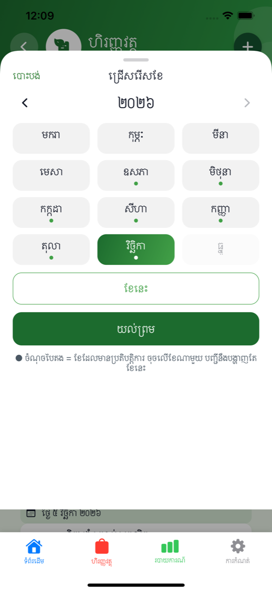

</td>
<td width="33%">

### 📊 លទ្ធផលប្រចាំខែ
សេចក្តីលម្អិតប្រចាំខែសម្រាប់ខែតុលា ២០២៦ (ខែ តុលា ២០២៦) បង្ហាញចំណូល 1,950,000៛ ចំណាយ 960,000៛ និងចំណេញ 990,000៛ ជាមួយបញ្ជីប្រតិបត្តិការ។

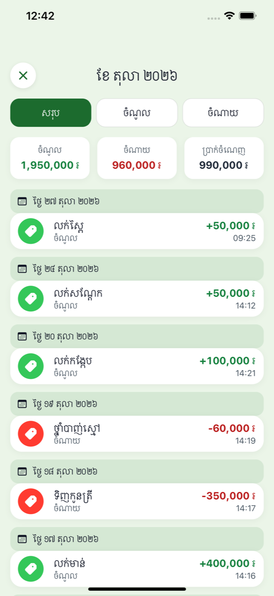

</td>
</tr>

<tr>
<td width="33%">

### ➕ បញ្ចូលប្រតិបត្តិការ
ទម្រង់បញ្ចូលប្រតិបត្តិការជាមួយប៊ូតុងប្តូរប្រភេទ (ចំណូល/ចំណាយ) វាលចំនួនទឹកប្រាក់ ជ្រើសរើសកាលបរិច្ឆេទ ជ្រើសរើសរូបិយប័ណ្ណ និងវាលកំណត់ចំណាំ។

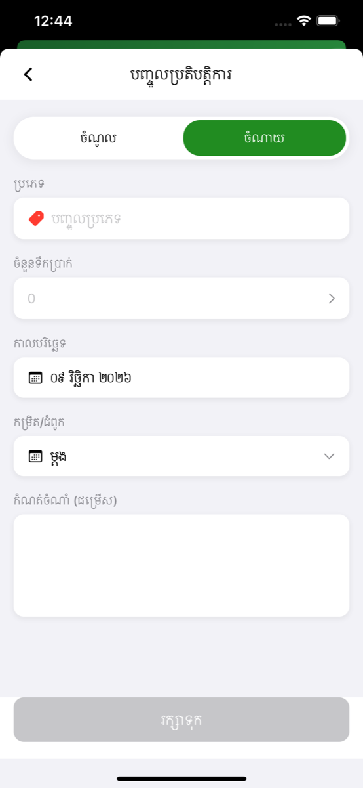

</td>
<td width="33%">

### 📈 របាយការណ៍
ទិដ្ឋភាពទូទៅរបាយការណ៍ប្រចាំខែជាមួយសេចក្តីសង្ខេបចំណេញ ក្រាហ្វិកប្រចាំសប្តាហ៍បង្ហាញនិន្នាការចំណូល/ចំណាយ និងដ្យាក្រាមបែងចែកប្រភេទចំណាយ។

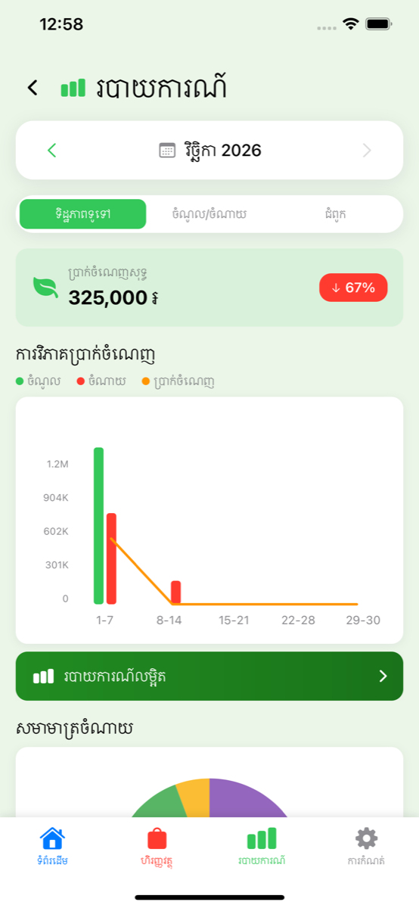

</td>
<td width="33%">

### 📊 របាយការណ៍លម្អិត
ទិដ្ឋភាពវិភាគទូលំទូលាយជាមួយការជ្រើសរើសពេលវេលា (7/30/90 ថ្ងៃ 1 ឆ្នាំ) កាតសង្ខេប ដ្យាក្រាម donut ប្រភេទចំណាយ និងការបង្ហាញនិន្នាការចំណូល។

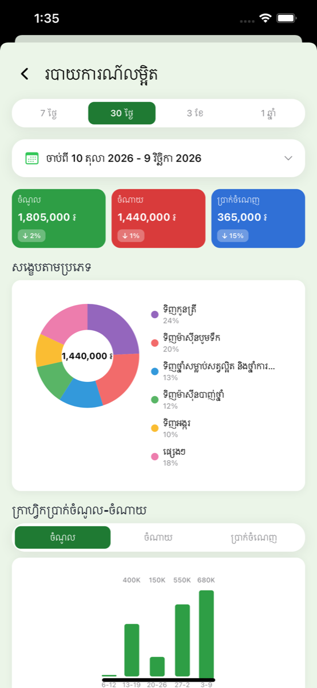

</td>
</tr>

<tr>
<td width="33%">

### ⚙️ ការកំណត់
មជ្ឈមណ្ឌលការកំណត់ជាមួយកាតប្រវត្តិរូបកសិដ្ឋាន ចំណូលចិត្តភាសា/រូបិយប័ណ្ណ ជម្រើសបម្រុងទុក/ស្តារ និងការចូលប្រើធនធានជំនួយ។

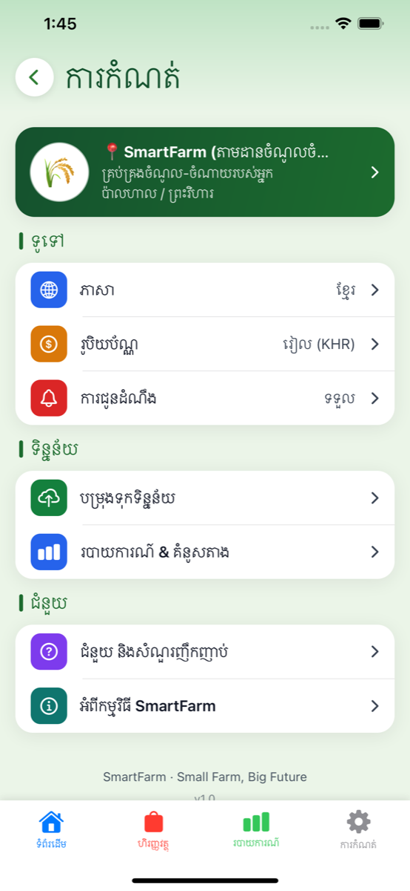

</td>
<td width="33%">

### 🌐 ជ្រើសរើសភាសា
ការគាំទ្រភាសាទ្វេជាមួយខ្មែរ (ខ្មែរ) ជាលំនាំដើម និងជម្រើសភាសាអង់គ្លេសសម្រាប់ការប្រែភាសាទូទាំងកម្មវិធី។

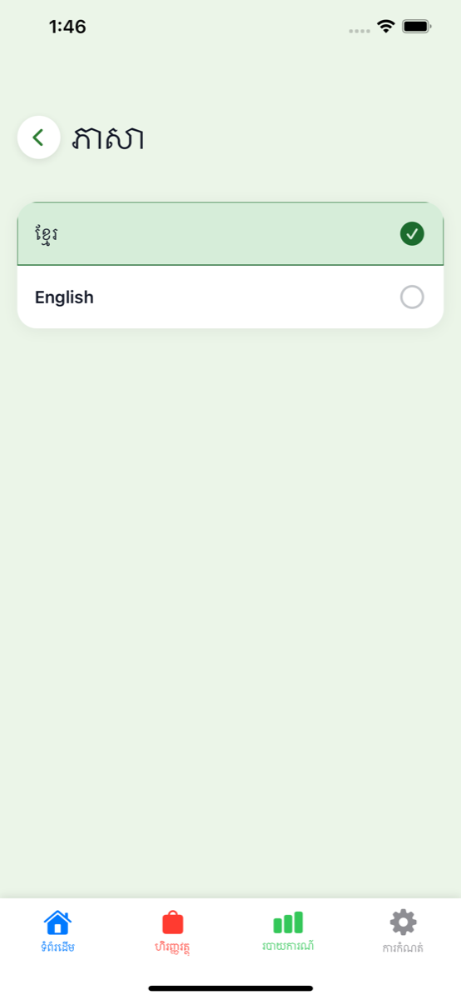

</td>
<td width="33%">

### 💵 ជ្រើសរើសរូបិយប័ណ្ណ
ការគាំទ្ររូបិយប័ណ្ណពីរ៖ រៀលកម្ពុជា (រៀល - KHR) និង ដុល្លារអាមេរិក (ដុល្លារ - USD) សម្រាប់ចំណូលចិត្តបង្ហាញ។

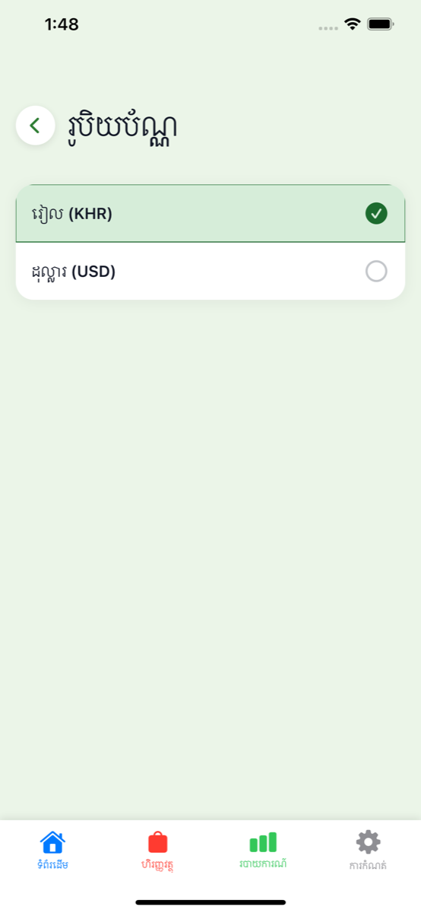

</td>
</tr>

<tr>
<td width="33%">

### 💾 បម្រុងទុក និងស្តារ
ប្រព័ន្ធបម្រុងទុកទិន្នន័យនាំចេញប្រតិបត្តិការទៅជាទម្រង់ JSON ជាមួយមុខងារស្តារសម្រាប់ការទាញយកទិន្នន័យឡើងវិញ។

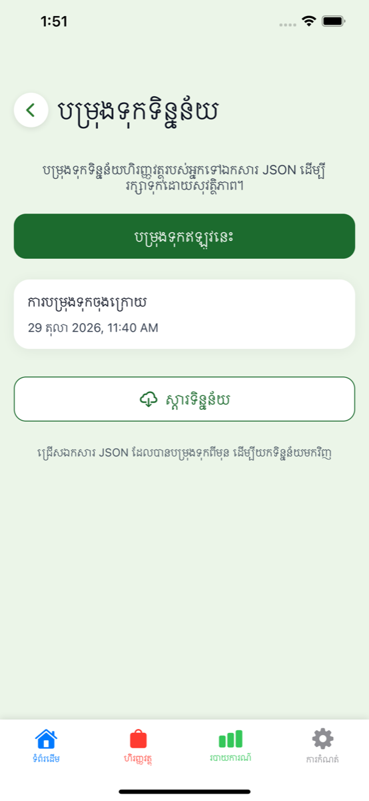

</td>
<td width="33%">

### ❓ ជំនួយ និងសំណួរញឹកញាប់
សំណួរញឹកញាប់ 5 ចំណុច។ ចុចលើសំណួរណាមួយដើម្បីបើកអេក្រង់ចម្លើយដែលនៅតែបើករហូតដល់អ្នកប្រើចុចប៊ូតុងត្រឡប់ក្រោយ។


</td>
<td width="33%">

### ❓ ចម្លើយ FAQ ទី ១
អេក្រង់ចម្លើយសំណួរញឹកញាប់លើកទី១ បង្ហាញរូបតំណាងពណ៌ខៀវ សំណួរ និងចម្លើយលម្អិតនៅក្នុងកាតពណ៌ស។


</td>
</tr>

<tr>
<td width="33%">

### ❓ ចម្លើយ FAQ ទី ២
អេក្រង់ចម្លើយសំណួរញឹកញាប់លើកទី២ បង្ហាញរូបតំណាងពណ៌ទឹកក្រូច សំណួរ និងចម្លើយលម្អិតនៅក្នុងកាតពណ៌ស។

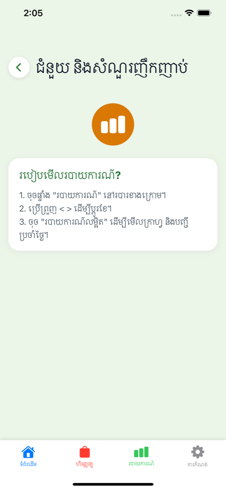

</td>
<td width="33%">

### ❓ ចម្លើយ FAQ ទី ៣
អេក្រង់ចម្លើយសំណួរញឹកញាប់លើកទី៣ បង្ហាញរូបតំណាងពណ៌ស្វាយ សំណួរ និងចម្លើយលម្អិតនៅក្នុងកាតពណ៌ស។


</td>
<td width="33%">

### ❓ ចម្លើយ FAQ ទី ៤
អេក្រង់ចម្លើយសំណួរញឹកញាប់លើកទី៤ បង្ហាញរូបតំណាងពណ៌បៃតង សំណួរ និងចម្លើយលម្អិតនៅក្នុងកាតពណ៌ស។

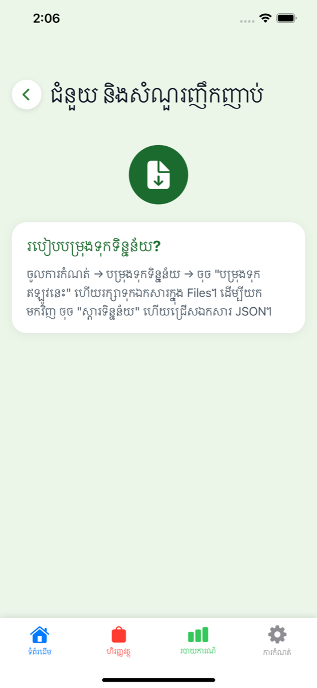

</td>
</tr>

<tr>
<td width="33%">

### ❓ ចម្លើយ FAQ ទី ៥
អេក្រង់ចម្លើយសំណួរញឹកញាប់លើកទី៥ បង្ហាញរូបតំណាងពណ៌ត្នោត សំណួរ និងចម្លើយលម្អិតនៅក្នុងកាតពណ៌ស។


</td>
<td width="33%">

### ℹ️ អំពីកម្មវិធី
អេក្រង់ព័ត៌មានកម្មវិធីបង្ហាញ SmartFarm កំណែ 1.0 រូបតំណាងកម្មវិធី និងការពិពណ៌នាមុខងារសំខាន់។

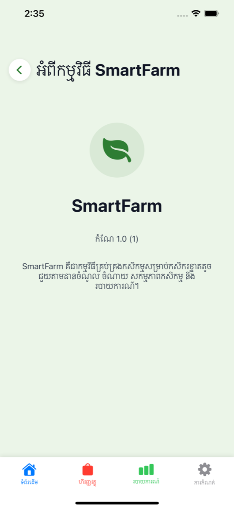

</td>
</tr>
</table>

---

## 🏗️ ស្ថាបត្យកម្ម

SmartFarm អនុវត្តតាមគំរូ **MVVM + Repository + Coordinator** ជាមួយការបំបែកភារកិច្ចយ៉ាងតឹងរឹង៖

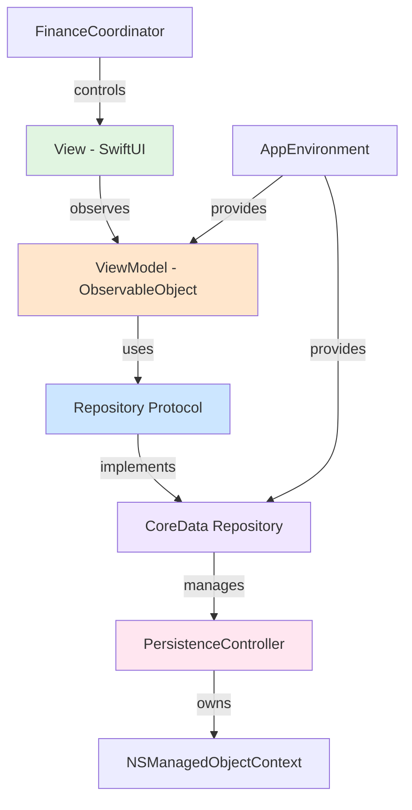

**គោលការណ៍សំខាន់៖**
- **Views** មិនដែល import CoreData ទេ គ្រាន់តែបង្ហាញ domain models (`Transaction`, `FarmActivity`, `Reminder`)
- **ViewModels** ពឹងផ្អែកលើ repository **protocols** អនុញ្ញាតឱ្យធ្វើតេស្ត unit testing ជាមួយ mocks
- **Repositories** គឺជាប្រភពទិន្នន័យតែមួយគត់សម្រាប់ការផ្គូផ្គង Entity ↔ Domain struct
- **AppEnvironment** ផ្តល់ dependency injection សម្រាប់ ViewModels និង Repositories ទាំងអស់
- **Coordinator** (FinanceCoordinator) គ្រប់គ្រងការរុករកផ្ទាំង និងការបញ្ជូនទៅទិដ្ឋភាពលម្អិត

---

## 🧭 ចលនាការរុករក

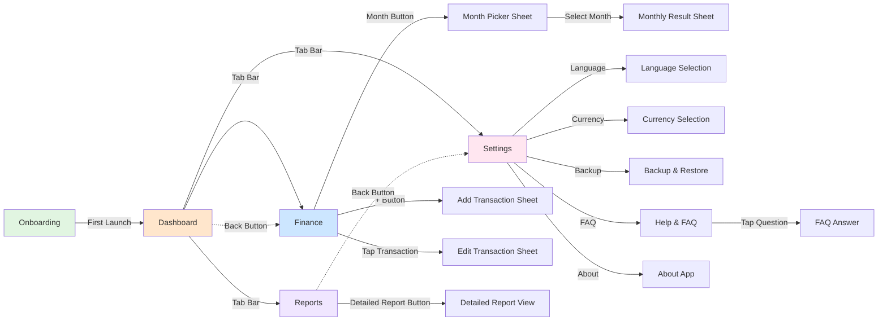

**ចលនាអ្នកប្រើប្រាស់៖**
1. **ការចាប់ផ្តើមដំបូង**៖ អេក្រង់ស្វាគមន៍ → ទំព័រដើម
2. **ការរុករកមុខ**៖ ផ្ទាំង 4 (ទំព័រដើម ហិរញ្ញវត្ថុ របាយការណ៍ ការកំណត់)
3. **ហិរញ្ញវត្ថុ**៖ រកមើលប្រតិបត្តិការ ច្រោះតាមខែ បន្ថែម/កែប្រែធាតុ
4. **របាយការណ៍**៖ មើលក្រាហ្វិក ការវិភាគលម្អិត
5. **ការកំណត់**៖ កំណត់រចនាសម្ព័ន្ធភាសា រូបិយប័ណ្ណ បម្រុងទុក/ស្តារទិន្នន័យ

---

## 💾 ចលនាទិន្នន័យ

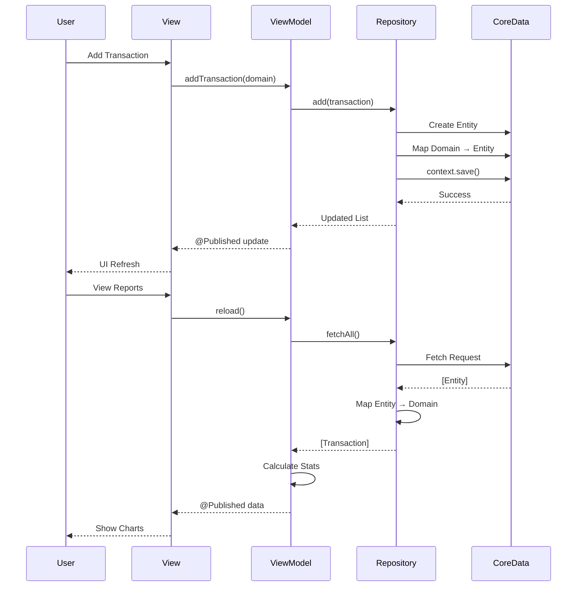

**ជំហានចលនា៖**
1. អ្នកប្រើប្រាស់ធ្វើអន្តរកម្មជាមួយ **SwiftUI View**
2. View ហៅវិធីសាស្ត្រ **ViewModel**
3. ViewModel ប្រើ **Repository Protocol**
4. Repository អនុវត្តប្រតិបត្តិការ **CoreData**
5. Entities ត្រូវបានផ្គូផ្គងទៅ **Domain Models**
6. ViewModel បោះពុម្ពផ្សាយការធ្វើបច្ចុប្បន្នភាពតាមរយៈ **@Published**
7. View បង្ហាញឡើងវិញដោយស្វ័យប្រវត្តិ

---

## 🗄️ គំរូ CoreData

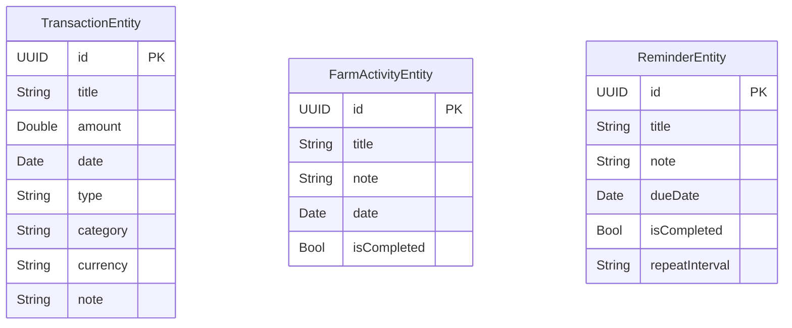

**Entities:**
- **TransactionEntity**៖ កំណត់ត្រាចំណូល/ចំណាយជាមួយចំនួនទឹកប្រាក់ ប្រភេទ រូបិយប័ណ្ណ
- **FarmActivityEntity**៖ ភារកិច្ចកសិដ្ឋានជាមួយស្ថានភាពបញ្ចប់
- **ReminderEntity**៖ ការរំឭកដែលបានកំណត់ពេលជាមួយចន្លោះពេលម្តងទៀត

**ការរក្សាទុក៖**
- ហាងជាអចិន្ត្រៃយ៍៖ `SmartFarm.xcdatamodeld`
- Context៖ `NSManagedObjectContext` តែមួយគត់គ្រប់គ្រងដោយ `PersistenceController`
- ការរក្សាទុកទាំងអស់ត្រូវបានការពារដោយ `hasChanges` guard

---

## 📅 ពេលវេលាអភិវឌ្ឍន៍

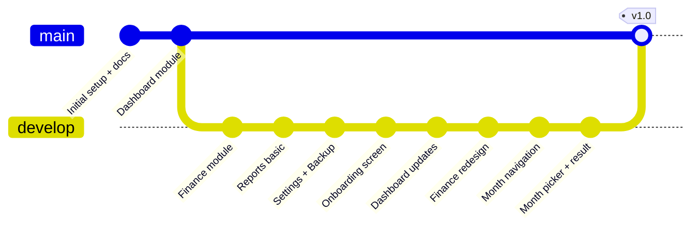

**ចំណុចសំខាន់៖**
- **ការរៀបចំដំបូង** (2024)៖ ឯកសារស្ថាបត្យកម្ម លក្ខណៈបច្ចេកទេសម៉ូឌុល ប្រព័ន្ធរចនា
- **ទំព័រដើម** (2024)៖ អេក្រង់មុខជាមួយកាតសង្ខេប និងសកម្មភាពរហ័ស
- **ហិរញ្ញវត្ថុ** (2025)៖ បញ្ជីប្រតិបត្តិការ ទម្រង់បន្ថែម/កែប្រែ ការច្រោះតាមខែ
- **របាយការណ៍** (2025)៖ ក្រាហ្វិក ការវិភាគ ការរុករកតាមខែ
- **ការកំណត់** (2025)៖ ចំណូលចិត្ត បម្រុងទុក/ស្តារ សំណួរញឹកញាប់ អំពី
- **ទំព័រស្វាគមន៍** (2026)៖ អេក្រង់ស្វាគមន៍សម្រាប់អ្នកប្រើប្រាស់ថ្មី
- **ការកែលម្អហិរញ្ញវត្ថុ** (2026)៖ ផ្ទាំងជ្រើសរើសខែ ទិដ្ឋភាពលទ្ធផលប្រចាំខែ

**Commits ថ្មីៗ៖**
```
ba25d40 Finance: add calendar button with month picker sheet
fa825b4 Settings redesign with sub-screens, FAQ, backup/restore
f7f4b4c Redesign Finance screen: green scrolling banner, search
b330fc2 Add month navigation to Reports screen
a20e31d Improve DetailedReportView: thinner bar chart
```

---

## ✨ មុខងារ

### 📊 ការគ្រប់គ្រងហិរញ្ញវត្ថុ
- ✅ **តាមដានប្រតិបត្តិការ**៖ កត់ត្រាចំណូល និងចំណាយជាមួយប្រភេទ
- ✅ **រូបិយប័ណ្ណច្រើន**៖ គាំទ្រ KHR (៛) និង USD ($)
- ✅ **ការច្រោះតាមខែ**៖ មើលប្រតិបត្តិការតាមខែជាក់លាក់
- ✅ **ស្វែងរក និងច្រោះ**៖ ស្វែងរកប្រតិបត្តិការតាមពាក្យគន្លឹះ ប្រភេទ ឬចំណាត់ថ្នាក់
- ✅ **សកម្មភាពរហ័ស**៖ ការចូលប្រើរហ័សដើម្បីបន្ថែមចំណូល/ចំណាយពីទំព័រដើម

### 📈 របាយការណ៍ និងការវិភាគ
- ✅ **ការវិភាគចំណេញ**៖ និន្នាការចំណេញប្រចាំខែ/សប្តាហ៍ជាមួយភាគរយផ្លាស់ប្តូរ
- ✅ **ការបែងចែកចំណាយ**៖ ការចំណាយតាមប្រភេទជាមួយក្រាហ្វិក pie
- ✅ **ក្រាហ្វិកប្រាំង**៖ ការបង្ហាញចំណូលទល់នឹងចំណាយតាមសប្តាហ៍
- ✅ **ការជ្រើសរើសពេលវេលា**៖ ទិដ្ឋភាព 7 ថ្ងៃ 30 ថ្ងៃ 3 ខែ 1 ឆ្នាំ
- ✅ **ការវិភាគលម្អិត**៖ ក្រាហ្វិក donut បន្ទាត់និន្នាការ កាតសង្ខេប

### ⚙️ ការកំណត់ និងចំណូលចិត្ត
- ✅ **ការគាំទ្រភាសាទ្វេ**៖ ខ្មែរ (លំនាំដើម) និង អង់គ្លេស
- ✅ **ការជ្រើសរើសរូបិយប័ណ្ណ**៖ ចំណូលចិត្តបង្ហាញ KHR ឬ USD
- ✅ **ការបម្រុងទុកទិន្នន័យ**៖ នាំចេញប្រតិបត្តិការទាំងអស់ទៅ JSON
- ✅ **ការស្តារទិន្នន័យ**៖ នាំចូលប្រតិបត្តិការពីឯកសារបម្រុងទុក
- ✅ **ជំនួយ និងសំណួរញឹកញាប់**៖ សំណួរទូទៅ 5 ចំណុច ចុចដើម្បីបើកអេក្រង់ចម្លើយ

### 🎨 បទពិសោធន៍អ្នកប្រើប្រាស់
- ✅ **ទំព័រស្វាគមន៍**៖ អេក្រង់ស្វាគមន៍សម្រាប់អ្នកប្រើប្រាស់ថ្មី
- ✅ **Offline-First**៖ ទិន្នន័យទាំងអស់រក្សាទុកក្នុងឧបករណ៍ មិនត្រូវការអ៊ីនធឺណិត
- ✅ **ត្រៀមជាស្រេចសម្រាប់ Dark Mode**៖ គាំទ្រចំណូលចិត្តរូបរាងប្រព័ន្ធ
- ✅ **កាលបរិច្ឆេទមូលដ្ឋាន**៖ លេខខ្មែរ និងទម្រង់ទ្រង់ទ្រាយកាលបរិច្ឆេទ
- ✅ **សមាសធាតុផ្ទាល់ខ្លួន**៖ ប្រព័ន្ធរចនាដែលអាចប្រើឡើងវិញបាន (FarmCard, SummaryCardView ។ល។)

---

## 🛠️ បណ្តុំបច្ចេកវិទ្យា

### បច្ចេកវិទ្យាសំខាន់
- **SwiftUI**៖ ក្របខ័ណ្ឌ UI declarative (iOS 14+)
- **CoreData**៖ ស្រទាប់ persistence មូលដ្ឋាន
- **Combine**៖ ការសរសេរកម្មវិធី reactive (@Published, ObservableObject)
- **Swift 5.0**៖ ភាសាសរសេរកម្មវិធីសំខាន់
- **Xcode 13.x**៖ បរិស្ថានអភិវឌ្ឍន៍ (objectVersion 55)

### គំរូស្ថាបត្យកម្ម
- **MVVM**៖ ការបំបែក Model-View-ViewModel
- **Repository Pattern**៖ ស្រទាប់ចូលប្រើទិន្នន័យផ្អែកលើ protocol
- **Coordinator Pattern**៖ ការរុករក និងការបញ្ជូន (FinanceCoordinator)
- **Dependency Injection**៖ AppEnvironment ផ្តល់ ViewModels និង Repositories
- **Domain-Driven Design**៖ ការផ្គូផ្គង Entity ↔ Domain Model

### ប្រព័ន្ធរចនា
- **Theme**៖ ពណ៌ពុម្ពអក្សរ គម្លាតកណ្តាល (`Core/DesignSystem/Theme.swift`)
- **Components**៖ ធាតុ UI ដែលអាចប្រើឡើងវិញបាន (FarmCard, PrimaryButton, SectionHeader)
- **Localization**៖ LocalizationManager ជាមួយ helper `L("key")`
- **Utilities**៖ CurrencyFormatter, LocalizedDate, NotificationService

### ឧបករណ៍អភិវឌ្ឍន៍
- **xcodeproj gem**៖ ការរៀបចំគម្រោង Xcode តាមកម្មវិធី
- **Bundler**៖ ការគ្រប់គ្រង dependency Ruby
- **Git**៖ ការគ្រប់គ្រងកំណែជាមួយសាខាមុខងារ

---

## 📁 រចនាសម្ព័ន្ធគម្រោង

```
SmartFarm/
├── App/
│   ├── SmartFarmApp.swift          # ចំណុចចូលកម្មវិធី
│   ├── AppEnvironment.swift        # ធុងផ្ទុក DI
│   └── AppSettings.swift           # ចំណូលចិត្តអ្នកប្រើប្រាស់
│
├── Core/
│   ├── Repositories/               # ស្រទាប់ចូលប្រើទិន្នន័យ
│   │   ├── TransactionRepository.swift
│   │   ├── FarmActivityRepository.swift
│   │   └── ReminderRepository.swift
│   ├── DesignSystem/
│   │   ├── Theme.swift            # ពណ៌ ពុម្ពអក្សរ គម្លាត
│   │   └── Components/            # សមាសធាតុ UI ដែលអាចប្រើឡើងវិញបាន
│   ├── Localization/
│   │   └── LocalizationManager.swift
│   └── Utilities/
│       ├── CurrencyFormatter.swift
│       ├── LocalizedDate.swift
│       ├── NotificationService.swift
│       ├── DocumentPicker.swift
│       └── ActivityShareSheet.swift
│
├── Onboarding/
│   └── OnboardingView.swift       # អេក្រង់ស្វាគមន៍
│
├── Dashboard/
│   ├── Models/
│   ├── ViewModels/
│   │   └── DashboardViewModel.swift
│   └── Views/
│       ├── MainTabView.swift      # ការរុករកផ្ទាំង 4
│       └── DashboardView.swift
│
├── Finance/
│   ├── Models/
│   │   ├── Transaction.swift
│   │   ├── TransactionEntity+CoreDataClass.swift
│   │   └── TransactionEntity+CoreDataProperties.swift
│   ├── ViewModels/
│   │   ├── FinanceViewModel.swift
│   │   └── FinanceCoordinator.swift
│   └── Views/
│       ├── FinanceTabView.swift
│       ├── AddEditTransactionView.swift
│       ├── MonthPickerSheet.swift
│       └── MonthlyResultSheet.swift
│
├── Reports/
│   ├── ViewModels/
│   │   └── ReportsViewModel.swift
│   └── Views/
│       ├── ReportsView.swift
│       ├── DetailedReportView.swift
│       └── MonthlyBarChartView.swift
│
├── Settings/
│   ├── SettingsView.swift
│   ├── LanguageSelectionView.swift
│   ├── CurrencySelectionView.swift
│   ├── FarmProfileEditView.swift
│   ├── HelpFAQView.swift
│   └── AboutAppView.swift
│
├── Backup/
│   ├── BackupView.swift
│   └── BackupService.swift
│
├── en.lproj/
│   └── Localizable.strings        # ការបកប្រែអង់គ្លេស
├── km.lproj/
│   └── Localizable.strings        # ការបកប្រែខ្មែរ
│
├── Persistence.swift              # PersistenceController
├── SmartFarm.xcdatamodeld/        # គំរូ CoreData
│
└── docs/
    ├── screenshots/               # រូបភាពអេក្រង់កម្មវិធី (PNG)
    ├── 00-architecture.md         # លក្ខណៈបច្ចេកទេសស្ថាបត្យកម្ម
    ├── 01-finance.md              # លក្ខណៈបច្ចេកទេសម៉ូឌុលហិរញ្ញវត្ថុ
    ├── 02-splash.md               # លក្ខណៈបច្ចេកទេស Splash
    ├── 07-reports.md              # លក្ខណៈបច្ចេកទេសរបាយការណ៍
    ├── 08-settings.md             # លក្ខណៈបច្ចេកទេសការកំណត់
    ├── 09-localization.md         # លក្ខណៈបច្ចេកទេស i18n
    ├── index.html                 # មើលរចនាជាមុន
    └── question.html              # ការស្ទង់មតិអ្នកប្រើប្រាស់
```

---

## 🚀 របៀបដំណើរការ

### តម្រូវការជាមុន
- **macOS**៖ Big Sur 11.0 ឬថ្មីជាងនេះ
- **Xcode**៖ 13.x (មកជាមួយ iOS 15 SDK)
- **iOS Deployment Target**៖ 14.0 (កំណែ iOS ទាបបំផុតដែលគាំទ្រ)
- **iOS Simulator**៖ iOS 15.2+ ណែនាំ ឬឧបករណ៍ពិតប្រាកដដែលដំណើរការ iOS 14.0+

### ជំហាន

1. **Clone repository:**
   ```bash
   git clone https://github.com/Davy17601/smartfarm.git
   cd smartfarm
   ```

2. **បើកក្នុង Xcode:**
   ```bash
   open SmartFarm.xcodeproj
   ```

3. **ជ្រើសរើសគោលដៅ:**
   - ជ្រើសរើស scheme `SmartFarm`
   - ជ្រើសរើស simulator iOS 15.2+ ឬឧបករណ៍ដែលបានភ្ជាប់

4. **Build និងដំណើរការ:**
   - ចុច `⌘R` ឬចុចប៊ូតុង Play
   - កម្មវិធីនឹងចាប់ផ្តើមជាមួយអេក្រង់ស្វាគមន៍ (លើកដំបូងតែប៉ុណ្ណោះ)

### ការបន្ថែមឯកសារ Swift ថ្មី

ឯកសារ `.swift` ថ្មីត្រូវតែត្រូវបានចុះឈ្មោះក្នុងគម្រោង Xcode៖

```bash
# ដំឡើង xcodeproj gem (មួយដង)
bundle install

# បន្ថែមឯកសារថ្មីទៅគម្រោង
bundle exec ruby -e "require 'xcodeproj'; \
  proj = Xcodeproj::Project.open('SmartFarm.xcodeproj'); \
  ref = proj.main_group.find_subpath('SmartFarm/Finance/Views', true).new_file('NewView.swift'); \
  proj.targets.first.add_file_references([ref]); proj.save"
```

### Build តាមបន្ទាត់ពាក្យបញ្ជា

```bash
xcodebuild -project SmartFarm.xcodeproj \
  -scheme SmartFarm \
  -destination 'platform=iOS Simulator,name=iPhone 12 Pro Max,OS=15.2' \
  build
```

---

## ⚠️ កំណត់

### កំហិតបច្ចុប្បន្ន
- **iOS 14.0 ទាបបំផុត**៖ ត្រូវគាំទ្រ Xcode 13 ជាមួយ iOS 14 deployment target
- **គ្មាន Swift Charts**៖ ក្របខ័ណ្ឌ iOS 16+ មិនមាន ប្រើក្រាហ្វិក GeometryReader ផ្ទាល់ខ្លួន
- **គ្មាន `.searchable()`**៖ modifier iOS 15+ មិនមាន ប្រើការស្វែងរក TextField ផ្ទាល់ខ្លួន
- **ទិន្នន័យមូលដ្ឋានតែប៉ុណ្ណោះ**៖ ទិន្នន័យទាំងអស់រក្សាទុកក្នុង CoreData គ្មានការធ្វើសមកាលកម្ម cloud ឬការបម្រុងទុកពីចម្ងាយ
- **សំណួរញឹកញាប់ថេរ**៖ សំណួរ 5 ត្រូវបាន hardcoded ក្នុង localization strings មិនមែន UI ដែលអាចពង្រីកបាន
- **អ្នកប្រើប្រាស់តែមួយ**៖ គ្មានការគាំទ្រអ្នកប្រើប្រាស់ច្រើន ឬគណនីអ្នកប្រើប្រាស់
- **គ្មានការនាំចេញទៅ CSV/PDF**៖ មុខងារបម្រុងទុកនាំចេញ JSON តែប៉ុណ្ណោះ
- **ការបញ្ចូលរូបិយប័ណ្ណដោយដៃ**៖ គ្មានការបំប្លែងរូបិយប័ណ្ណដោយស្វ័យប្រវត្តិ ឬអត្រាប្តូរប្រាក់

### ការសម្រេចចិត្តរចនា
- **Offline-First**៖ ការរចនាចេតនាសម្រាប់កសិករដែលមានអ៊ីនធឺណិតមានកំណត់
- **ប្រភេទសាមញ្ញ**៖ បញ្ជីប្រភេទថេរសម្រាប់ភាពងាយស្រួលប្រើប្រាស់ (មិនអាចប្តូរតាមអ្នកប្រើប្រាស់)
- **ទិដ្ឋភាពប្រចាំខែ**៖ បានធ្វើឱ្យប្រសើរសម្រាប់វដ្តកសិដ្ឋានប្រចាំខែជាជាងការតាមដានប្រចាំថ្ងៃ
- **ភាសាទ្វេតែប៉ុណ្ណោះ**៖ ខ្មែរ និងអង់គ្លេសគាំទ្រ ភាសាផ្សេងទៀតត្រូវការការបន្ថែមឯកសារ localization

### បញ្ហាដែលដឹង
- **Xcode 13 ត្រូវការ**៖ អ្នករួមចំណែកត្រូវប្រើ Xcode 13.x សម្រាប់ភាពត្រូវគ្នាដែលធានា
- **គ្មានតេស្ត**៖ test suite unit មិនទាន់ត្រូវបានអនុវត្ត (ស្ថាបត្យកម្មគាំទ្រ mock repositories)
- **ទិន្នន័យ Preview**៖ previews មួយចំនួនប្រើទិន្នន័យ placeholder ជំនួស CoreData ផ្ទាល់

---

## 👨‍💻 អ្នកនិពន្ធ

**SmartFarm v1.0**

សាងសង់ដោយ ❤️ សម្រាប់កសិករខ្នាតតូចកម្ពុជា។

**អភិវឌ្ឍដោយ:**
- **Davy** - [@Davy17601](https://github.com/Davy17601)

---

## 📄 អាជ្ញាប័ណ្ណ

គម្រោងនេះត្រូវបានផ្តល់អាជ្ញាប័ណ្ណក្រោម MIT License - សូមមើលឯកសារ [LICENSE](LICENSE) សម្រាប់ព័ត៌មានលម្អិត។

---

## 🙏 ការទទួលស្គាល់

- **កសិករកម្ពុជា**៖ សម្រាប់ការបំផុសគំនិតគម្រោងនេះ និងការផ្តល់មតិកែលម្អពិតប្រាកដ
- **សហគមន៍ SwiftUI**៖ សម្រាប់សមាសធាតុ open-source និងការអនុវត្តល្អបំផុត
- **ធនធានរចនា**៖ រូបតំណាង ពុម្ពអក្សរ និងធនធានរូបភាពពី Apple SF Symbols

---

**SmartFarm** · Small Farm, Big Future 🌾
